<div align="center">



# Hi, I'm Mustafa Yamin 👋

**AI & Full-Stack Developer · AI Agents · MCP · Next.js · Python**<br/>
I build AI agents, multi-agent pipelines and full-stack web apps that solve real problems.

<a href="https://github.com/MustafaYamin">
  
</a>

<br/>

<a href="https://www.linkedin.com/in/mustafa-yamin/"></a>
<a href="https://www.instagram.com/cod.eze/"></a>
<a href="https://portfolio-sage-chi-17.vercel.app"></a>
<a href="https://github.com/MustafaYamin"></a>

</div>

---

## 🧠 About Me

I'm an **AI & Full-Stack Developer** at **Inseyab**, based in Karachi, Pakistan. I work across the stack: building **AI agents with tool calling**, wiring up **MCP integrations**, and shipping fast, clean front ends in **Next.js**.

I also run **[cod.eze](https://www.instagram.com/cod.eze/)**, where I explain AI and dev concepts in 60 seconds, and the free **cod.eze Dev Community** on Discord.

```ts
const mustafa = {
  role:      "AI & Full-Stack Developer @ Inseyab",
  location:  "Karachi, Pakistan 🇵🇰",
  focus:     ["AI Agents", "MCP", "Multi-Agent Systems", "Full-Stack Web"],
  languages: ["TypeScript", "Python", "JavaScript", "SQL"],
  frontend:  ["Next.js", "React", "Tailwind CSS"],
  backend:   ["FastAPI", "Node.js", "Prisma", "MySQL"],
  ai:        ["LLM Agents", "Function Calling", "RAG", "Claude", "OpenAI", "Qwen"],
  creator:   "cod.eze: Tech & AI explainers",
  openTo:    ["Collaborations", "Freelance AI projects", "Open source"],
};
```

---

## 🛠️ Tech Stack

**Languages**


**AI & Agents**


**Frontend**


**Backend & Database**


**Tools**


---

## 🚀 Featured Projects

| Project | Description | Tech Stack |
|---|---|---|
| 🧩 [**100 Free MCP Servers**](https://github.com/MustafaYamin/100-free-mcp-servers) | Curated collection of 100 free, open-source Model Context Protocol servers with full documentation. | MCP · AI · Docs |
| 🤖 [**Personal AI FTE**](https://github.com/MustafaYamin/Personal-AI-FTE) | Local-first personal AI employee that automates personal and business tasks 24/7. | Python · Qwen Code · Obsidian |
| 🚢 [**Logistics CRM**](https://github.com/MustafaYamin/logistics-crm-nextjs) | Full-stack freight & agent management system with RBAC and Excel bulk import. | Next.js 14 · Prisma · MySQL |
| 🧠 [**AI Mustaqbil 2.0**](https://github.com/MustafaYamin/AI-Mustaqbil-2.0) | Multi-agent hackathon build: autonomous pipelines where agents think and collaborate. | Multi-Agent · LLMs |
| 📅 [**AI Event Planner**](https://github.com/MustafaYamin/AI-Event-Planner-Frontend) | Conversational AI that plans events, searches venues and books via Google Calendar. | Next.js · FastAPI · OpenAI |
| ✋ [**HandLoom**](https://github.com/MustafaYamin/handLoom) | Real-time two-hand tracking that threads a glowing, animated web of light. | JavaScript · Computer Vision |

<p align="center"><a href="https://github.com/MustafaYamin?tab=repositories">➡️ <b>See all repositories</b></a></p>

---

## 📊 GitHub Stats

<div align="center">


</div>

---

## ⚡ Quick Facts

- 💼 AI & Full-Stack Developer at **Inseyab**
- 🤖 Building **AI agents, MCP tools and multi-agent systems**
- 🏆 Hackathons: **NASA Space Apps**, **AI Mustaqbil 2.0**, **Marketplace Builder**, **UI/UX Hackathon**
- 📱 Creator of **[cod.eze](https://www.instagram.com/cod.eze/)**: tech & AI explained in 60 seconds
- 🤝 Open to collaborations, freelance AI work and open source

---

<p align="center"><i>Building AI that actually works, one agent at a time.</i></p>
